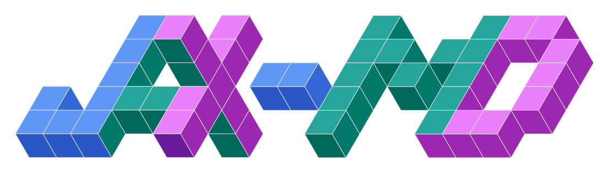

<div align="center">


### 高性能硬件加速、端到端可微分分子动力学框架
</div>

[English](README.md) | [简体中文](README.zh.md)

[**快速入门**](#快速入门-getting-started) | [**安装指南**](#安装指南-installation) | [**参考文档**](https://jax-md.readthedocs.io/en/main/) | [**论文**](https://arxiv.org/pdf/1912.04232.pdf) | [**NeurIPS 2020**](https://neurips.cc/virtual/2020/public/poster_83d3d4b6c9579515e1679aca8cbc8033.html)

[](https://github.com/jax-md/jax-md/actions/workflows/build.yml)  [](https://pypi.org/project/jax-md/) [](https://github.com/google/jax-md/blob/main/LICENSE)

分子动力学（Molecular Dynamics, MD）是现代计算凝聚态物理学的核心支柱。它被广泛用于材料模拟，以观察微观小尺度相互作用如何涌现出宏观复杂的物理现象。传统的分子动力学软件包（如 HOOMD-Blue 或 LAMMPS）通常是高度专用且极其繁复的代码库，包含成千上万行代码。为了兼容 CPU 和 GPU 上的模拟运行，这些软件中通常存在大量的重复代码实现；此外，为了计算物理感兴趣的衍生量（例如对能量求梯度以获得受力），大量代码被迫投入到手工解析或数值求导中。

然而，近年来机器学习领域的软件基础设施演进带来了突破性进展，使编写更简洁、性能更卓越的分子动力学模拟系统成为可能。JAX MD 依托 Google JAX 框架构建：JAX 允许开发者编写纯 Python 代码并将其经由 XLA 编译到 CPU、GPU 或 TPU 上高效运行。更为关键的是，JAX 具备自动微分能力——这意味着分子动力学模拟不仅能够自动获得硬件加速，而且具备**端到端全流程可微**特性。这为可微物理模拟、参数逆向优化与机器学习力场结合等诸多前沿科学实验开辟了崭新的探索空间。

JAX MD 目前是一项处于活跃演进中的研究型开源项目。随着模拟支持范围的持续扩展，部分 API 可能会发生演进。JAX MD 采用函数式（Functional）与数据驱动（Data-driven）的设计理念：物理状态存储于数组或数组元组中，纯函数负责将系统从一种状态映射变换到另一种状态。

## 快速入门 (Getting Started)

如需观看介绍 JAX MD 的视频演讲与交互式 [Demo 演示](https://colab.research.google.com/github/google/jax-md/blob/main/notebooks/talk_demo.ipynb)，请参阅 Physics meets Machine Learning 系列演讲：

[](https://www.youtube.com/watch?v=Bkm8tGET7-w)

无需在本地安装任何环境，即可直接通过 Google Cloud 上的 Colab Notebook 上手体验 JAX MD。如需体验最简明的基础演示，推荐从能量最小化（Minimization）示例开始；如需系统全面了解 JAX MD 的各项核心特性，推荐查阅 JAX MD Cookbook：

- [JAX MD 烹饪手册 (Cookbook)](https://colab.research.google.com/github/google/jax-md/blob/main/notebooks/jax_md_cookbook.ipynb)
- [自定义相互作用势函数 (Custom Potentials)](https://colab.research.google.com/github/google/jax-md/blob/main/notebooks/customizing_potentials_cookbook.ipynb)
- [鸟群聚类群集行为 (Flocking)](https://colab.research.google.com/github/google/jax-md/blob/main/notebooks/flocking.ipynb)
- [元优化 (Meta Optimization)](https://colab.research.google.com/github/google/jax-md/blob/main/notebooks/meta_optimization.ipynb)
- [交换蒙特卡洛算法 (Swap Monte Carlo - Cargese Summer School)](https://colab.research.google.com/github/google/jax-md/blob/main/notebooks/cargese_swap_mc.ipynb)
- [隐式微分 (Implicit Differentiation)](https://colab.research.google.com/github/google/jax-md/blob/main/notebooks/implicit_differentiation.ipynb)
- [无热线性弹性 (Athermal Linear Elasticity)](https://colab.research.google.com/github/google/jax-md/blob/main/notebooks/athermal_linear_elasticity.ipynb)
- [撞击沙堡仿真 (Smash a Sand Castle)](https://colab.research.google.com/github/google/jax-md/blob/main/notebooks/sand_castle.ipynb)

JAX MD 还配备了开箱即用的独立本地 Python 脚本，在本地安装 JAX MD 后即可直接运行：

- [FIRE 能量最小化](examples/fire_minimization.py)
- [NVE 微正则系综模拟](examples/nve_simulation.py)
- [NVT 正则系综模拟](examples/nvt_simulation.py)
- [NPT 等温等压系综模拟](examples/npt_simulation.py)
- [带邻居列表 (Neighbor Lists) 的 NVE 模拟](examples/nve_neighbor_list.py)
- [神经网络势函数 (Neural Network Potentials)](examples/neural_networks.py)

有关核心库模块的完整特性全览，请参阅 [FEATURES.md](https://github.com/jax-md/jax-md/blob/main/FEATURES.md)。

## 安装指南 (Installation)

### 使用 uv 安装（推荐）

在本地开发中，推荐使用 [uv](https://docs.astral.sh/uv/) 进行环境管理：

```sh
git clone https://github.com/jax-md/jax-md
cd jax-md
uv sync --no-default-groups
```

如需包含测试与文档构建依赖，请运行：

```sh
uv sync --no-default-groups --group testing --group docs
```

### 使用 pip 安装

如需使用 pip 安装，可通过以下命令获取最新已发布的发行版本：

```sh
python -m pip install jax-md --upgrade
```

或以可编辑开发模式安装本地源码检出：

```sh
python -m pip install -e .
```

若使用 pip 25.1 或更高版本，可通过 `--group` 参数一并安装测试与文档依赖：

```sh
python -m pip install -e . --group testing --group docs
```

## 参与开发 (Development)

JAX MD 正处于积极开发中。非常欢迎提交 Feature Request 协助指引开发演进方向，热烈欢迎社区贡献！开发环境搭建说明请参阅 [CONTRIBUTING.md](CONTRIBUTING.md)。

## 单元测试 (Tests)

测试套件位于 `tests/` 目录下，并以双精度（Double Precision）模式运行：

使用 uv 运行全量测试套件：

```sh
JAX_ENABLE_X64=1 uv run --no-sync pytest
```

使用 uv 运行指定模块的测试套件：

```sh
JAX_ENABLE_X64=1 uv run --no-sync pytest tests/<suite>_test.py
```

若未使用 uv，可直接安装测试依赖并调用 pytest：

```sh
python -m pip install -e . --group testing
JAX_ENABLE_X64=1 python -m pytest
JAX_ENABLE_X64=1 python -m pytest tests/<suite>_test.py
```

建议在提 PR 前运行受您改动影响的测试模块。完整的开发环境配置说明请参阅 [CONTRIBUTING.md](CONTRIBUTING.md)。

## 技术注意事项 (Technical Gotchas)

### GPU 支持

必须遵循 [JAX 官方 GPU 安装指南](https://www.github.com/google/jax/) 配置驱动及对应的 CUDA/CUDNN 后端，以启用 GPU 硬件加速。

### 64 位双精度浮点数 (64-bit precision)

若要启用 64 位双精度模式，必须在**导入 `jax_md` 之前**显式设置对应的 JAX 标志位（详情参阅 JAX [常见问题手册](https://colab.research.google.com/github/google/jax/blob/main/notebooks/Common_Gotchas_in_JAX.ipynb#scrollTo=YTktlwTTMgFl)），示例代码如下：

```python
import jax
jax.config.update("jax_enable_x64", True)
```

## 相关学术出版物 (Publications)

JAX MD 已被诸多学术前沿研究采用。如果您的论文使用了 JAX MD 但尚未列入下表，欢迎提交 PR 或 Issue 进行补充收录：

1. [Molecular Simulations with a Pretrained Neural Network and Universal Pairwise Force Fields. (J. Am. Chem. Soc. 2025)](https://doi.org/10.1021/jacs.5c09558)<br> A. Kabylda, J. T. Frank, S. Suárez-Dou, A. Khabibrakhmanov, L. Medrano Sandonas, O. T. Unke, S. Chmiela, K.-R. Müller, and A. Tkatchenko
2. [Designing precise dynamical steady states in disordered networks. (Machine Learning: Science and Technology (2025))](https://iopscience.iop.org/article/10.1088/2632-2153/ade590/meta)<br> M. Berneman and D. Hexner
3. [Generalized design of sequence-ensemble-function relationships for intrinsically disordered proteins](https://www.biorxiv.org/content/10.1101/2024.10.10.617695v1)<br> R. K. Krueger, M. P. Brenner, and K. Shrinivas
4. [Tuning colloidal reactions. (PRL 2024)](https://arxiv.org/abs/2312.07798v2)<br> R. K. Krueger, E. M. King, and M. P. Brenner
5. [Programming patchy particles for materials assembly design. (PNAS 2024)](https://www.pnas.org/doi/abs/10.1073/pnas.2311891121)<br> E. M. King, CX. Du, QZ. Zhu, S. S. Schoenholz, and M. P. Brenner
6. [LATTE: an atomic environment descriptor based on Cartesian tensor contractions. (arXiv 2024)](https://arxiv.org/abs/2405.08137)<br> F. Pellegrini, S. Gironcoli, E. Küçükbenli
7. [PySAGES: flexible, advanced sampling methods accelerated with GPUs. (npj Computational Materials 2024)](https://www.nature.com/articles/s41524-023-01189-z)<br> P. F. Zubieta Rico, et al.
8. [Scaling deep learning for materials discovery (Nature 2023)](https://www.nature.com/articles/s41586-023-06735-9)<br> A. Merchant, et al.
9. [LapTrack: linear assignment particle tracking with tunable metrics. (Bioinformatics 2023)](https://doi.org/10.1093/bioinformatics/btac799)<br> Yohsuke T Fukai and Kyogo Kawaguchi
10. [A Differentiable Neural-Network Force Field for Ionic Liquids. (J. Chem. Inf. Model. 2022)](https://pubs.acs.org/doi/abs/10.1021/acs.jcim.1c01380)<br> H. Montes-Campos, J. Carrete, S. Bichelmaier, L. M. Varela, and G. K. H. Madsen
11. [Correlation Tracking: Using simulations to interpolate highly correlated particle tracks. (Phys. Rev. E. 2022)](https://journals.aps.org/pre/abstract/10.1103/PhysRevE.105.044608?ft=1)<br> E. M. King, Z. Wang, D. A. Weitz, F. Spaepen, and M. P. Brenner
12. [Optimal Control of Nonequilibrium Systems Through Automatic Differentiation.](https://arxiv.org/abs/2201.00098)<br> M. C. Engel, J. A. Smith, and M. P. Brenner
13. [Graph Neural Networks Accelerated Molecular Dynamics. (J. Chem. Phys. 2022)](https://aip.scitation.org/doi/10.1063/5.0083060)<br> Z. Li, K. Meidani, P. Yadav, and A. B. Farimani
14. [Gradients are Not All You Need.](https://arxiv.org/abs/2111.05803)<br> L. Metz, C. D. Freeman, S. S. Schoenholz, and T. Kachman
15. [Lagrangian Neural Network with Differential Symmetries and Relational Inductive Bias.](https://arxiv.org/abs/2110.03266)<br> R. Bhattoo, S. Ranu, and N. M. A. Krishnan
16. [Efficient and Modular Implicit Differentiation.](https://arxiv.org/abs/2105.15183)<br> M. Blondel, Q. Berthet, M. Cuturi, R. Frostig, S. Hoyer, F. Llinares-López, F. Pedregosa, and J.-P. Vert
17. [Learning neural network potentials from experimental data via Differentiable Trajectory Reweighting.<br>(Nature Communications 2021)](https://www.nature.com/articles/s41467-021-27241-4)<br> S. Thaler and J. Zavadlav
18. [Learn2Hop: Learned Optimization on Rough Landscapes. (ICML 2021)](http://proceedings.mlr.press/v139/merchant21a.html)<br> A. Merchant, L. Metz, S. S. Schoenholz, and E. D. Cubuk
19. [Designing self-assembling kinetics with differentiable statistical physics models. (PNAS 2021)](https://www.pnas.org/content/118/10/e2024083118.short)<br> C. P. Goodrich, E. M. King, S. S. Schoenholz, E. D. Cubuk, and  M. P. Brenner

## 引用 JAX MD (Citation)

如果您在学术研究中使用了 JAX MD，请使用以下 BibTeX 条目进行引用：

```bibtex
@inproceedings{jaxmd2020,
 author = {Schoenholz, Samuel S. and Cubuk, Ekin D.},
 booktitle = {Advances in Neural Information Processing Systems},
 publisher = {Curran Associates, Inc.},
 title = {JAX M.D. A Framework for Differentiable Physics},
 url = {https://papers.nips.cc/paper/2020/file/83d3d4b6c9579515e1679aca8cbc8033-Paper.pdf},
 volume = {33},
 year = {2020}
}
```

如果使用了与 `RigidBody`（刚体动力学）相关的特性，请一并引用以下论文：

```bibtex
@article{king2024programming,
  title={Programming patchy particles for materials assembly design},
  author={King, Ella M and Du, Chrisy Xiyu and Zhu, Qian-Ze and Schoenholz, Samuel S and Brenner, Michael P},
  journal={Proceedings of the National Academy of Sciences},
  volume={121},
  number={27},
  pages={e2311891121},
  year={2024},
  publisher={National Academy of Sciences}
}
```

---

> **说明**：本文档为基于英文原文的中文翻译版本。如翻译内容与英文原文存在不一致之处，请以 [英文原版 (README.md)](README.md) 为准。
